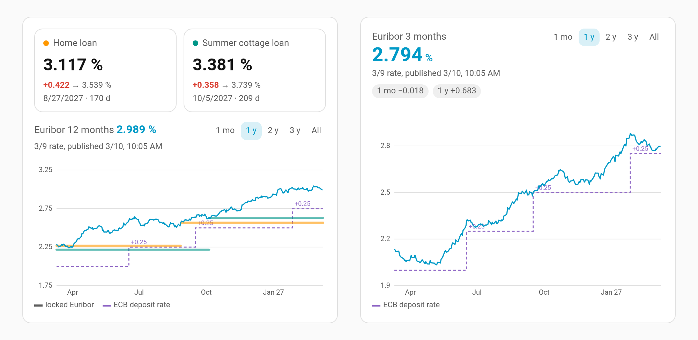
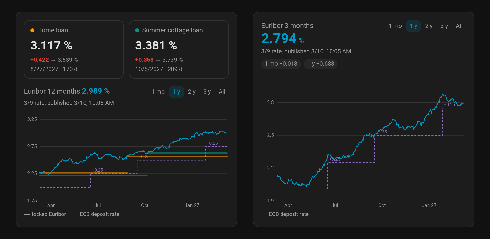
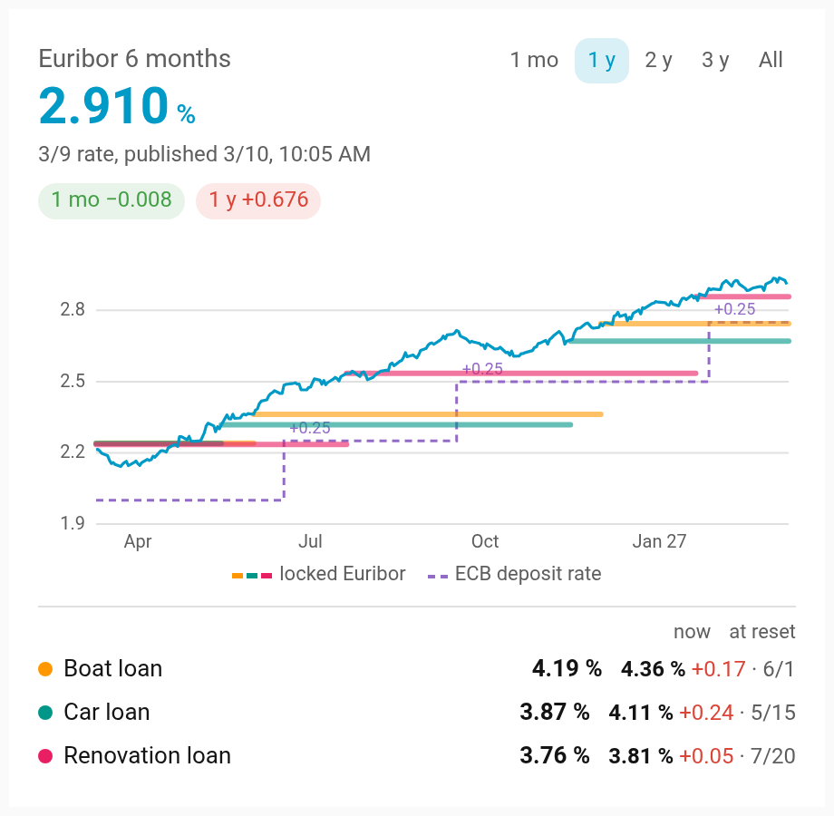
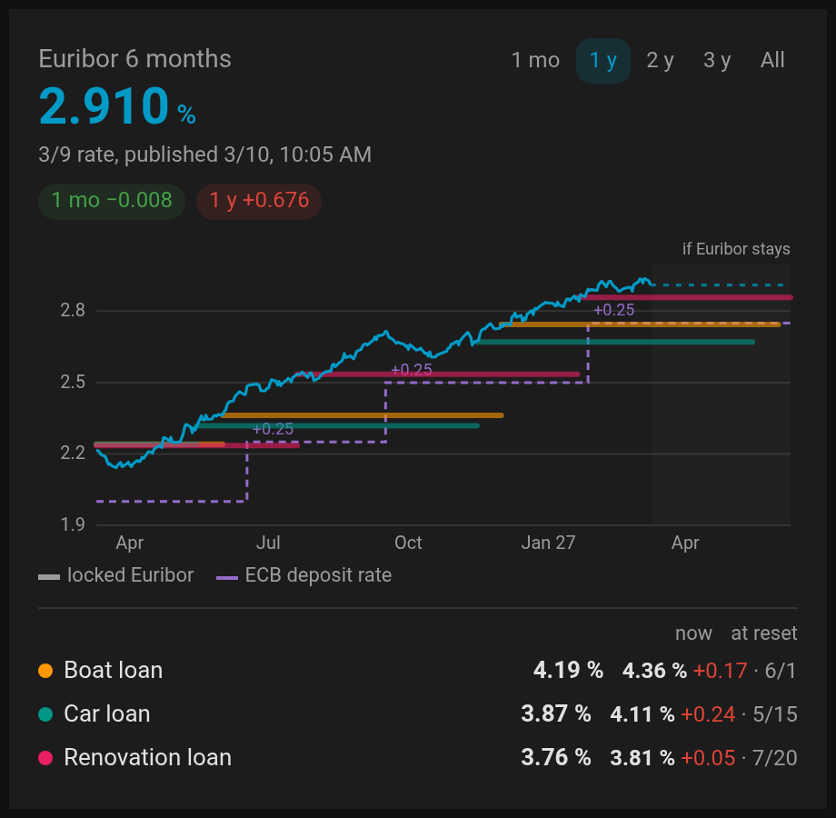
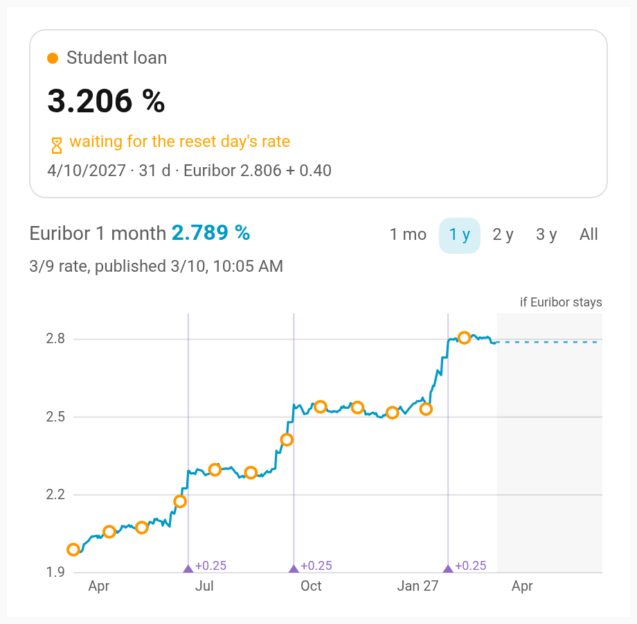
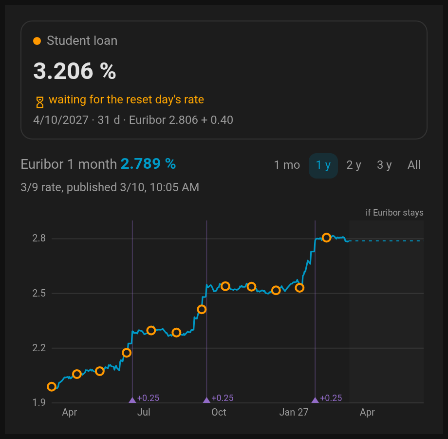

# Euribor rates for Home Assistant

Home Assistant integration for the Euribor rates, from Banco de España's statistics, with loans that follow them, the
ECB's deposit facility rate and a dashboard card.

[![GitHub Release][releases-shield]][releases] [![GitHub Release Date][release-date-shield]][releases] [![Downloads][downloads-shield]][releases] [![Marketplace][marketplace-shield]][marketplace] [![License][license-shield]](LICENSE)




The rates and loans in the pictures are made up.

## What is it?

A custom component that follows the Euribor rates from [Banco de España](https://www.bde.es/). Add the integration
once and give it a maturity, and add more maturities to it whenever you like. Each one gets a sensor for its newest
rate, another for when that rate was published, and a third that keeps its history.

The rates of earlier days are kept in Home Assistant's own long term statistics, so years of Euribor can be drawn with
any card that reads statistics, and the numbers survive a restart and the recorder's purging.

A loan tied to Euribor can be added too. Give it the maturity it follows, the bank's margin and the day it started,
and it gets sensors for its interest rate, the Euribor that rate is locked to, the rate it would have at the newest
Euribor, how much that would change it and the day it is next reset. No helpers or automations are needed to keep them
up to date.

The European Central Bank's deposit facility rate can be followed as well, with its history, from the ECB's own data.

The integration comes with the [Euribor card](#euribor-card), which shows a maturity's rate and history with the loans
that follow it and the ECB's rate. It is added to your dashboards' resources by itself.

## Installation

### With the Marketplace

1. Open Settings › Marketplace and search for Euribor rates
2. Open it and choose Install
3. Restart Home Assistant
4. Add the integration in Settings › Devices & services, and choose a maturity

### Manual

1. Download the source code from the latest release
2. Copy the `custom_components/euribor_rates` folder to your Home Assistant installation's `config/custom_components`
   folder
3. Restart Home Assistant
4. Add the integration in Settings › Devices & services, and choose a maturity

## Settings

Adding the integration asks for the first maturity and how far back its history reaches. Further maturities are added
from the integration page with **Add maturity**, which leaves out the ones already being followed. Choosing
**Reconfigure** on a maturity changes how far back it reaches and writes that history again.

| Name              | Type   | Description                                                | Default |
| ----------------- | ------ | ---------------------------------------------------------- | ------- |
| Maturity          | enum   | `1 week`, `1 month`, `3 months`, `6 months` or `12 months` |         |
| History to import | number | How far back the history reaches, in days, up to 10950     | 365     |

### Loans

Loans are added from the integration page with **Add loan**, as many as you like, and **Reconfigure** on a loan changes
any of its settings. A loan doesn't need its maturity to be followed as well.

| Name                         | Type   | Description                                                                    | Default     |
| ---------------------------- | ------ | ------------------------------------------------------------------------------ | ----------- |
| Name                         | string | The name of the loan's device, which its sensors' names start with             |             |
| Reference rate               | enum   | `1 month`, `3 months`, `6 months` or `12 months`                               | `12 months` |
| Margin                       | number | The bank's margin, in percent, added to Euribor                                |             |
| Loan start date              | date   | The day the loan was drawn down, which its resets are counted from             |             |
| Rate locked before the reset | number | How many banking days before the reset day the bank locks the Euribor, 0 to 10 | 0           |

The rate is reset once per maturity, so a 12 month loan once a year, a 6 month one twice and a 3 month one four times.
The first reset is on the start date, and each one after it falls on the same day of the month, or on the month's last
day when the month is shorter. A loan started on 31 January is reset on 28 February and then on 31 March again, when it
follows the 1 month Euribor. The start date can't be in the future.

By default each reset locks the Euribor of the reset day. A reset on a Saturday or a Sunday locks Friday's rate, as
Euribor has none on weekends, and one on a holiday locks the last rate before it. A rate is published on the next
working day, so until the reset day's rate is out, the loan keeps the rate of the reset before. After a holiday, that
lasts until the rate of the day after it is out, as only then is it known that the holiday had no rate.

Some banks lock the rate of an earlier day, such as two banking days before the reset. Check your loan's terms and set
**Rate locked before the reset** to match. The banking days are counted as the days that have a Euribor rate, so
weekends and holidays are skipped. With 2, a reset on a Tuesday locks the rate of the Friday before, and the loan takes
it as soon as Monday's rate is out.

### The ECB's rate

**Add ECB rate** on the integration page follows the European Central Bank's deposit facility rate. It can be added
once, and **Reconfigure** changes how far back its history reaches.

| Name              | Type   | Description                                            | Default |
| ----------------- | ------ | ------------------------------------------------------ | ------- |
| History to import | number | How far back the history reaches, in days, up to 10950 | 365     |

## Sensors

Each maturity has three:

| Sensor                               | What it holds                                                       |
| ------------------------------------ | ------------------------------------------------------------------- |
| `sensor.euribor_12_months`           | The newest published rate, as a percentage                          |
| `sensor.euribor_12_months_published` | When that rate was published, as a timestamp                        |
| `sensor.euribor_12_months_history`   | The day of the newest rate, with the rates themselves in statistics |

The names follow Home Assistant's language, and so do the IDs of newly created sensors. In Finnish, for instance, the
history sensor of a new maturity is `sensor.euribor_12_kuukautta_historia`. The examples here use the English IDs, so
use the ones your sensors have. Existing sensors keep the IDs they were created with.

The rate sensor also carries `latest_rate`, `latest_date` and `maturity` as attributes.

The published sensor holds the time Banco de España saved its file with the newest rate, and the day that rate is for
as its `latest_date` attribute. It is the one to build a staleness alarm on. Rates come on working days, so a time
more than a few days old means something is wrong at the source. The bank saves the file again during the day without
new rates, so the time is kept until a newer rate comes. After a new installation, or when Home Assistant was not
running as the rate came, it is the time of the file's latest save, which can be a few hours after the publication.

### Loans

Each loan has a device of its own, named as the loan, with five sensors. For a loan called Home loan:

| Sensor                                          | What it holds                                               |
| ----------------------------------------------- | ----------------------------------------------------------- |
| `sensor.home_loan`                              | The loan's interest rate, the locked Euribor and the margin |
| `sensor.home_loan_reference_rate`               | The Euribor the rate is locked to                           |
| `sensor.home_loan_rate_at_the_newest_euribor`   | The rate the loan would have at the newest Euribor          |
| `sensor.home_loan_change_at_the_newest_euribor` | The newest Euribor less the locked one                      |
| `sensor.home_loan_next_reset`                   | The day the rate is next reset, as a date                   |

The interest rate sensor carries `margin`, `maturity`, `start_date`, `lock_days`, `reset_date` and `pending` as
attributes, and the reference rate sensor `rate_date`, `reset_date` and `pending`. `reset_date` is the reset that locked
the rate and `rate_date` the day of the Euribor it locked.
`pending` is true while a newer reset's rate isn't out yet, and the rates are still the previous reset's. The rate at
the newest Euribor carries that Euribor's day as `latest_date`. Like the maturities' sensors, their names and the IDs
of new sensors follow Home Assistant's language.

### The ECB's rate

| Sensor                                     | What it holds                                                   |
| ------------------------------------------ | --------------------------------------------------------------- |
| `sensor.ecb_deposit_facility_rate`         | The deposit facility rate in force, as a percentage             |
| `sensor.ecb_deposit_facility_rate_history` | The series' newest day, with the rates themselves in statistics |

The rate sensor carries `effective_date`, the day the rate took effect. The ECB gives a value for every day, weekends
included, so its history has one for each day too.

### The history

Every rate is written into the statistics of the history sensor, one value for each published day, under the day the
rate is for. The Euribor card draws it, and so do Home Assistant's own statistics graph card and apexcharts-card.
Euribor has no rate on weekends and holidays, so they have no value either.

The rates are kept apart from the rate sensor because each rate is published on the next working day. The rate sensor
always shows the rate of an earlier day, and Home Assistant's own statistics of it follow what it showed. The history
sensor has no state class, so Home Assistant keeps no statistics of its own for it, and its values are exactly the
published rates. They are stored without a unit, because the history sensor's state is a date. Add `unit: '%'` to a
chart to show one.

Banco de España publishes one file with every rate since Euribor began, on 30 December 1998, and adds the previous
working day's rates to it every working morning at about ten, Madrid time. The integration checks it every hour and
downloads it only when it has been saved since the last check. When the rates in it have changed, the whole history is
written again, as far back as the setting reaches, so an outage heals itself on the first update afterwards and a day
the source adds later is filled in. Days already in the statistics are rewritten, not added twice.

The ECB's rate is checked every hour too, and downloaded only when the ECB has saved it again, which it does every
night.

## Euribor card

<p>




</p>

The card shows one maturity's newest rate, its history on a chart, the loans that follow it and the ECB's rate. It
finds the maturity's other sensors, its loans and the ECB's rate by itself, so it is given only the maturity's rate
sensor.

### Card options

The card has a visual editor. Add **Euribor** from the card picker and choose the maturity. The options can also be
written by hand.

| Name             | Type   | Description                                                                                                                                                      | Default  |
| ---------------- | ------ | ---------------------------------------------------------------------------------------------------------------------------------------------------------------- | -------- |
| `type`           | string | `custom:euribor-card`                                                                                                                                            | required |
| `entity`         | string | A maturity's rate sensor, such as `sensor.euribor_12_months`                                                                                                     | required |
| `loans_on_chart` | string | The Euribor each of the loans' resets locked. `lines` draws it as a line to the next reset, `markers` as a circle on the day it was locked, `none` leaves it out | `lines`  |
| `ecb`            | string | The ECB's rate, once it is added to the integration. `steps` draws it as a step line, `markers` marks its changes on the axis, `none` leaves it out              | `steps`  |

### What it shows

The card changes its layout by the number of loans that follow the maturity.

- **No loans:** the newest rate large, its change over a month and a year, and the chart.
- **One or two loans:** a tile for each loan, with its rate, how much it would change at the newest Euribor and its
  next reset, then the rate on one line and the chart.
- **Three or more:** the newest rate and its changes, the chart, then a table of the loans with their rates now and at
  the next reset.

Each loan has a colour, the same in its tile or row and on the chart. The Euribor each of its resets locked is drawn
from the loan's start date on, worked out by the integration from Banco de España's whole history, so it reaches back
further than the maturity's own line when that line's history is shorter. Where loans show, a rise is red and a fall green,
as a borrower sees them. A loan whose reset day's rate isn't out yet says so in place of its change.

The chart shows a month, one, two, three or five years, or the whole history. Only the ranges the history reaches show
as choices. Pointing at the chart shows the day's rate and the ECB's rate that day. When the newest rate was published
more than four and a half days ago, the card dims it and says how long ago that was.

### Sizes

The card has a fixed height, and its chart takes the room the rest leaves. In a sections view it is 12 columns wide and
7 rows tall by default, and can be made shorter or taller in the layout tab. It needs at least 4 rows without loans, 6
with up to three, and a row more for every two loans after that. Elsewhere it is 440 pixels tall.

The colours come from the theme. The loans' colours can be changed with `--euribor-card-loan-1` to
`--euribor-card-loan-5`, the rate's with `--euribor-card-rate` and the ECB's with `--euribor-card-ecb`.

## Examples

The card for the 12 month Euribor, with the loans' resets as circles and the ECB's rate left out:

```yaml
type: custom:euribor-card
entity: sensor.euribor_12_months
loans_on_chart: markers
ecb: none
```

A chart of the rates with [apexcharts-card](https://github.com/RomRider/apexcharts-card), which reads the history
sensor's statistics. The rate sensor is a second series that only shows the newest rate in the header:

```yaml
type: custom:apexcharts-card
graph_span: 365d
header:
  show: true
  title: Euribor 12 months
  show_states: true
series:
  - entity: sensor.euribor_12_months_history
    name: Euribor 12 months
    statistics:
      type: mean
      period: day
    unit: "%"
    stroke_width: 1
    float_precision: 3
    show:
      in_header: false
  - entity: sensor.euribor_12_months
    name: Newest rate
    float_precision: 3
    show:
      in_chart: false
      in_header: raw
```

## Upgrading from 2.0

**Point your charts at the history sensor.** In 2.0 the rates were kept in the rate sensor's statistics, where they
were mixed with Home Assistant's own statistics of what the sensor showed. A chart on `sensor.euribor_12_months`
keeps working but shows those mixed values. Change its `entity` to `sensor.euribor_12_months_history` and add
`unit: '%'`, as in the apexcharts example above. The history sensor is new, so its ID follows Home Assistant's
language and may differ from the example. It reads the whole history on the first update after upgrading. The rate
sensor's existing statistics are left as they were, and the other sensors keep their IDs.

## Upgrading from 1.x

The maturities you follow, their sensors, their entity IDs and any names you have given them all carry over. Two
things change:

- **The `history` attribute is gone.** The rates now live in the history sensor's statistics instead, which is what
  the examples above read. A chart built on `entity.attributes.history` has to be changed to the `statistics` form.
- **The maturities are now inside one integration entry** rather than one entry each, so a maturity can only be added
  once and they are managed together.

## Data

Euribor rates: [Banco de España](https://www.bde.es/), from its table of money market rates
([ti_1_7.csv](https://www.bde.es/webbe/es/estadisticas/compartido/datos/csv/ti_1_7.csv)). Euribor® is a trademark of
the European Money Markets Institute (EMMI), and the rates are subject to
[EMMI's terms of use](https://www.emmi-benchmarks.eu/terms-of-use).

The deposit facility rate is data provided by the European Central Bank, from the
[ECB Data Portal](https://data.ecb.europa.eu/).

This integration is unofficial and not affiliated with or endorsed by Banco de España, EMMI or the European Central
Bank.

## Development

The integration requires Python 3.14.

```
python3.14 -m venv .venv
.venv/bin/pip install -r requirements_test.txt
.venv/bin/pytest
.venv/bin/ruff check .
```

The card's source is in `frontend/`, in TypeScript with lit, built with esbuild into
`custom_components/euribor_rates/www/euribor-card.js`, which is committed. `npm run check` there formats, lints,
type-checks, tests and builds it.

```
cd frontend
npm ci
npm run check
```

| Path                           | What it contains                                           |
| ------------------------------ | ---------------------------------------------------------- |
| `__init__.py`                  | Setup                                                      |
| `migration.py`                 | Turning the entries of 1.x into one                        |
| `config_flow.py`               | Adding the integration, its maturities, loans and ECB rate |
| `const.py`                     | The sources' addresses, the series and the limits          |
| `api.py`                       | Fetching Banco de España's file for every maturity         |
| `rates.py`                     | Reading the rates in it                                    |
| `ecb.py`                       | Fetching and reading the ECB's deposit facility rate       |
| `loans.py`                     | A loan's reset days and the rate each one locks            |
| `exceptions.py`                | The error for a source that fails                          |
| `statistics.py`                | Keeping the rates in long term statistics                  |
| `coordinator.py`               | Fetching and storing, every hour                           |
| `sensor.py`                    | The maturities', the loans' and the ECB's sensors          |
| `card.py`                      | Serving the card and keeping its dashboard resource        |
| `websocket.py`                 | The command the card asks a loan's lock periods with       |
| `translations/<language>.json` | Home Assistant UI texts                                    |
| `frontend/src/`                | The card                                                   |

The README's screenshots come from made-up data in `docs/screenshots.json`.

## Support

Hey dude! Help me out for a couple of :beers: or a :coffee:!

[](https://www.buymeacoffee.com/jesmak)

## License

MIT, see [LICENSE](LICENSE). The rates are subject to EMMI's terms of use, see [Data](#data).

[releases-shield]: https://img.shields.io/github/release/jesmak/euribor_rates.svg?style=for-the-badge
[release-date-shield]: https://img.shields.io/github/release-date/jesmak/euribor_rates?style=for-the-badge
[releases]: https://github.com/jesmak/euribor_rates/releases
[downloads-shield]: https://img.shields.io/github/downloads/jesmak/euribor_rates/total.svg?style=for-the-badge
[marketplace-shield]: https://img.shields.io/badge/Marketplace-Default-green.svg?style=for-the-badge
[marketplace]: https://my.home-assistant.io/redirect/marketplace_repository/?owner=jesmak&repository=euribor_rates&category=integration
[license-shield]: https://img.shields.io/github/license/jesmak/euribor_rates.svg?style=for-the-badge
