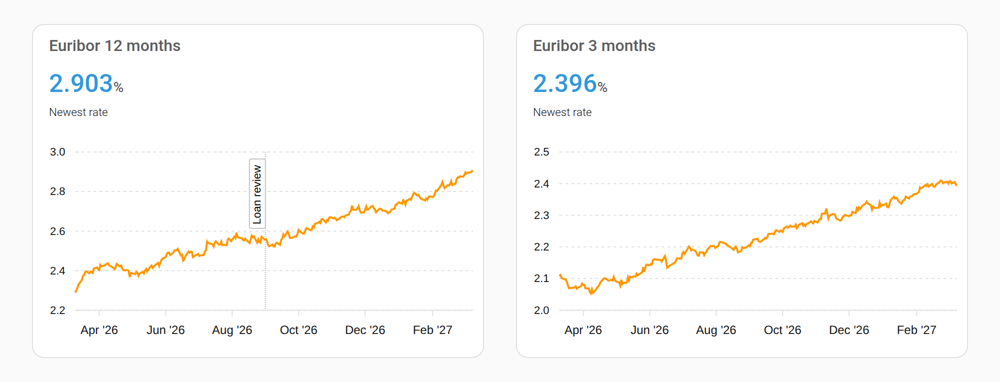
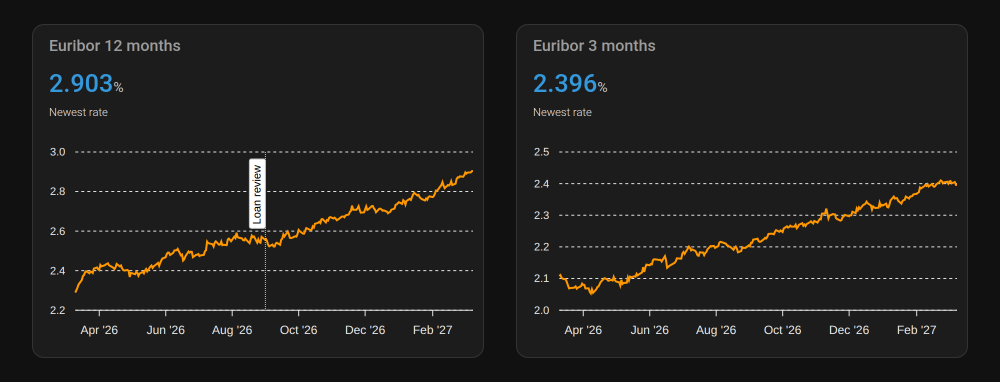

# Euribor rates for Home Assistant

Home Assistant integration for the Euribor rates, from Banco de España's statistics.

[![GitHub Release][releases-shield]][releases] [![GitHub Release Date][release-date-shield]][releases] [![Downloads][downloads-shield]][releases] [![Marketplace][marketplace-shield]][marketplace] [![License][license-shield]](LICENSE)




The rates in the picture are made up.

## What is it?

A custom component that follows the Euribor rates from [Banco de España](https://www.bde.es/). Add the integration
once and give it a maturity, and add more maturities to it whenever you like. Each one gets a sensor for its newest
rate, another for the day that rate was published, and a third that keeps its history.

The rates of earlier days are kept in Home Assistant's own long term statistics, so years of Euribor can be drawn with
any card that reads statistics, and the numbers survive a restart and the recorder's purging.

## Installation

### With the Marketplace

1. Open Settings › Marketplace, choose Add from link and paste `https://github.com/jesmak/euribor_rates`
2. Open Euribor rates in the Marketplace and choose Install
3. Restart Home Assistant
4. Add the integration in Settings › Devices & services, and choose a maturity

### Manual

1. Download the source code from the latest release
2. Copy the `custom_components/euribor_rates` folder to your Home Assistant installation's `config/custom_components`
   folder
3. Restart Home Assistant
4. Add the integration in Settings › Devices & services, and choose a maturity

## Settings

Adding the integration asks for the first maturity and how far back its history reaches. Further maturities are added
from the integration page with **Add maturity**, which leaves out the ones already being followed. Choosing
**Reconfigure** on a maturity changes how far back it reaches and writes that history again.

| Name              | Type   | Description                                                | Default |
| ----------------- | ------ | ---------------------------------------------------------- | ------- |
| Maturity          | enum   | `1 week`, `1 month`, `3 months`, `6 months` or `12 months` |         |
| History to import | number | How far back the history reaches, in days, up to 10950     | 365     |

## Sensors

Each maturity has three:

| Sensor                               | What it holds                                                       |
| ------------------------------------ | ------------------------------------------------------------------- |
| `sensor.euribor_12_months`           | The newest published rate, as a percentage                          |
| `sensor.euribor_12_months_published` | The day that rate was published                                     |
| `sensor.euribor_12_months_history`   | The day of the newest rate, with the rates themselves in statistics |

The names follow Home Assistant's language, and so do the IDs of newly created sensors. In Finnish, for instance, the
history sensor of a new maturity is `sensor.euribor_12_kuukautta_historia`. The examples here use the English IDs, so
use the ones your sensors have. Existing sensors keep the IDs they were created with.

The rate sensor also carries `latest_rate`, `latest_date` and `maturity` as attributes. The published sensor is the
one to build a staleness alarm on. Rates come on working days, so a publication date more than a few days old means
something is wrong at the source.

### The history

Every rate is written into the statistics of the history sensor, one value for each published day, under the day the
rate is for. Home Assistant's own statistics graph card draws it, and so does apexcharts-card. Weekends and holidays
have no rate, so they have no value either.

The rates are kept apart from the rate sensor because each rate is published on the next working day. The rate sensor
always shows the rate of an earlier day, and Home Assistant's own statistics of it follow what it showed. The history
sensor has no state class, so Home Assistant keeps no statistics of its own for it, and its values are exactly the
published rates. They are stored without a unit, because the history sensor's state is a date. Add `unit: '%'` to a
chart to show one.

Banco de España publishes one file with every rate since Euribor began, on 30 December 1998, and adds the previous
working day's rates to it every working morning at about ten, Madrid time. The integration checks it every hour and
downloads it only when it has been saved since the last check. When the rates in it have changed, the whole history is
written again, as far back as the setting reaches, so an outage heals itself on the first update afterwards and a day
the source adds later is filled in. Days already in the statistics are rewritten, not added twice.

## Examples

A chart of the rates with [apexcharts-card](https://github.com/RomRider/apexcharts-card), which reads the history
sensor's statistics. The rate sensor is a second series that only shows the newest rate in the header:

```yaml
type: custom:apexcharts-card
graph_span: 365d
header:
  show: true
  title: Euribor 12 months
  show_states: true
series:
  - entity: sensor.euribor_12_months_history
    name: Euribor 12 months
    statistics:
      type: mean
      period: day
    unit: '%'
    stroke_width: 1
    float_precision: 3
    show:
      in_header: false
  - entity: sensor.euribor_12_months
    name: Newest rate
    float_precision: 3
    show:
      in_chart: false
      in_header: raw
```

The charts in the picture above add a straight line, a coloured header and annotations marking the days a loan's rate
is reviewed:

```yaml
type: custom:apexcharts-card
graph_span: 365d
header:
  show: true
  title: Euribor 12 months
  show_states: true
  colorize_states: true
all_series_config:
  curve: straight
apex_config:
  chart:
    height: 220px
  legend:
    show: false
  annotations:
    xaxis:
      - x: 1788210000000 # a timestamp in milliseconds
        label:
          style:
            color: '#000'
          text: Loan review
series:
  - entity: sensor.euribor_12_months_history
    statistics:
      type: mean
      period: day
    unit: '%'
    stroke_width: 2
    float_precision: 3
    name: Rate of the day
    show:
      in_header: false
  - entity: sensor.euribor_12_months
    name: Newest rate
    float_precision: 3
    show:
      in_chart: false
      in_header: raw
```

## Upgrading from 2.0

**Point your charts at the history sensor.** In 2.0 the rates were kept in the rate sensor's statistics, where they
were mixed with Home Assistant's own statistics of what the sensor showed. A chart on `sensor.euribor_12_months`
keeps working but shows those mixed values. Change its `entity` to `sensor.euribor_12_months_history` and add
`unit: '%'`, as in the examples above. The history sensor is new, so its ID follows Home Assistant's language and may
differ from the example. It reads the whole history on the first update after upgrading. The rate sensor's existing
statistics are left as they were, and the other sensors keep their IDs.

## Upgrading from 1.x

The maturities you follow, their sensors, their entity IDs and any names you have given them all carry over. Two
things change:

- **The `history` attribute is gone.** The rates now live in the history sensor's statistics instead, which is what
  the examples above read. A chart built on `entity.attributes.history` has to be changed to the `statistics` form.
- **The maturities are now inside one integration entry** rather than one entry each, so a maturity can only be added
  once and they are managed together.

## Data

Euribor rates: [Banco de España](https://www.bde.es/), from its table of money market rates
([ti_1_7.csv](https://www.bde.es/webbe/es/estadisticas/compartido/datos/csv/ti_1_7.csv)). Euribor® is a trademark of
the European Money Markets Institute (EMMI), and the rates are subject to
[EMMI's terms of use](https://www.emmi-benchmarks.eu/terms-of-use).

This integration is unofficial and not affiliated with or endorsed by Banco de España or EMMI.

## Development

Requires Python 3.14.

```
python3.14 -m venv .venv
.venv/bin/pip install -r requirements_test.txt
.venv/bin/pytest
.venv/bin/ruff check .
```

| Path                           | What it contains                                       |
| ------------------------------ | ------------------------------------------------------ |
| `__init__.py`                  | Setup                                                  |
| `migration.py`                 | Turning the entries of 1.x into one                    |
| `config_flow.py`               | Adding the integration and its maturities              |
| `const.py`                     | The source's address, the series and the limits        |
| `api.py`                       | Fetching Banco de España's file for every maturity     |
| `rates.py`                     | Reading the rates in it                                |
| `exceptions.py`                | The error for a source that fails                      |
| `statistics.py`                | Keeping the rates in long term statistics              |
| `coordinator.py`               | Fetching and storing, every hour                       |
| `sensor.py`                    | The rate, its publication day and the history          |
| `translations/<language>.json` | Home Assistant UI texts                                |

The README's screenshots come from made-up data in `docs/screenshots.json`.

## Support

Hey dude! Help me out for a couple of :beers: or a :coffee:!

[](https://www.buymeacoffee.com/jesmak)

## License

MIT, see [LICENSE](LICENSE). The rates are subject to EMMI's terms of use, see [Data](#data).

[releases-shield]: https://img.shields.io/github/release/jesmak/euribor_rates.svg?style=for-the-badge
[release-date-shield]: https://img.shields.io/github/release-date/jesmak/euribor_rates?style=for-the-badge
[releases]: https://github.com/jesmak/euribor_rates/releases
[downloads-shield]: https://img.shields.io/github/downloads/jesmak/euribor_rates/total.svg?style=for-the-badge
[marketplace-shield]: https://img.shields.io/badge/Marketplace-Custom-orange.svg?style=for-the-badge
[marketplace]: https://my.home-assistant.io/redirect/marketplace_repository/?owner=jesmak&repository=euribor_rates&category=integration
[license-shield]: https://img.shields.io/github/license/jesmak/euribor_rates.svg?style=for-the-badge
